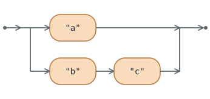

# Zwei Q3-Übungsklausuren · Syntaxlabor V4.1

Selbst erstellte abiturorientierte Übungsaufgaben, keine offiziellen Abituraufgaben. Je 40 BE. Die Empfehlung von 100 Minuten ist eine eigene didaktische Setzung. Diese thematischen Arbeiten ersetzen keine vollständige Informatikabiturprüfung.

Die verwendeten Buchstaben verweisen auf die Teilaufgaben im Aufgabenkatalog. Alle hier zusammengestellten Teilaufgaben sind zu bearbeiten. Erwartungshorizonte beginnen erst im zweiten Abschnitt des Dokuments.

## Übungsklausur 1 · Logistik und Grammatik · Aufgabenblatt

Eigene Zeit­empfehlung: 100 Minuten. Alle drei Aufgabenblöcke bearbeiten.

### A1 · Eine Kette aus a und ein Schlusszeichen

Gegeben ist S → aS | b.

**a) Gib N, T und das Startsymbol an.** (AFB I, 3 BE)

**b) Gib die Produktionsmenge P an.** (AFB I, 1 BE)

**c) Leite aaab vollständig ab. Eine Satzform pro Zeile oder ⇒ verwenden.** (AFB II, 4 BE)

**f) Begründe, weshalb aba nicht erzeugt werden kann.** (AFB II, 2 BE)

### E1 · Paketnummern im Logistikzentrum

Eine Paketnummer beginnt mit P oder E. Danach folgen genau drei Dezimalziffern. Optional folgen ein Bindestrich und genau zwei weitere Ziffern. Die Nummer endet mit X.

**a) Entwickle eine EBNF-Grammatik mit der Regel ziffer.** (AFB II, 5 BE)

**b) Zeichne die Paketstruktur selbst. Die Ziffernregel ist bereits angelegt.** (AFB II, 5 BE)

**c) Prüfe die Paketnummern.** (AFB II, 4 BE)

`P123X`, `E007-42X`, `P12X`, `E123-4X`

**d) Beschreibe die Sprache und begründe ihre Regularität.** (AFB II, 3 BE)

**e) Entwickle eine Erweiterung: Zusätzlich ist Pakettyp R erlaubt. Nur R hat genau vier Ziffern und darf keinen Bindestrich-Zusatz enthalten. P und E behalten ihre bisherigen Regeln.** (AFB III, 5 BE)

### D6 · Ein falscher Alternativzweig

Das dargestellte Diagramm soll wort = ("a" | "b") "c"; entsprechen. Im gezeigten Diagramm fehlt c jedoch nach a.



**a) Korrigiere die Struktur grafisch.** (AFB II, 5 BE)

**b) Vergleiche den fehlerhaften Vorschlag mit der Zielgrammatik. Gib bei Ungleichheit ein Gegenbeispiel an.** (AFB II, 3 BE)

Vorgegebene EBNF:

```ebnf
wort = "a" | "b" "c";
```

## Übungsklausur 2 · Messdaten und Strukturen · Aufgabenblatt

Eigene Zeit­empfehlung: 100 Minuten. Alle drei Aufgabenblöcke bearbeiten.

### A3 · Links oder rechts zuerst?

S → AB
A → aA | a
B → bB | b

**a) Leite aabb als Linksableitung ab.** (AFB II, 4 BE)

**b) Leite aabb als Rechtsableitung ab.** (AFB II, 4 BE)

**c) Erstelle einen Ableitungsbaum für aabb. Klicke ein Nichtterminal und wähle seine Produktion.** (AFB II, 4 BE)

**d) Vergleiche die beiden Ableitungen: Was bleibt gleich?** (AFB II, 2 BE)

**e) Nenne die Nichtterminal- und Terminalmengen.** (AFB I, 2 BE)

### E5 · Sensor- und Messdaten

Ein Datensatz besteht aus T oder H, einem Doppelpunkt, optional einem Minus und mindestens einer Dezimalziffer. Optional folgen ein Punkt und genau eine Nachkommastelle. Der Datensatz endet mit #.

**a) Entwickle eine EBNF.** (AFB II, 5 BE)

**b) Zeichne das Messungsdiagramm; die Ziffernregel ist vorgegeben.** (AFB II, 5 BE)

**d) Beurteile: Die Grammatik garantiert Luftfeuchtigkeit von 0 bis 100 Prozent.** (AFB III, 3 BE)

**e) Entwickle eine neue Fassung mit sensorabhängiger Genauigkeit: Nur T darf weiterhin genau eine Nachkommastelle besitzen. H muss ganzzahlig sein. Beide Typen dürfen weiterhin ein Minus und beliebig viele Vorkommastellen besitzen.** (AFB III, 5 BE)

### B2 · Linkslinear und rechtslinear

Vergleiche G1: S → Sa | b und G2: S → aS | b.

**a) Ordne jede vorliegende Grammatik nach ihrer Produktionsform ein. Wähle die engste nachgewiesene Klasse (größte Typnummer).** (AFB II, 2 BE)

G1:

```text
S → Sa | b
```

G2:

```text
S → aS | b
```

**b) Erzeugen beide Grammatiken dieselbe Sprache?** (AFB II, 1 BE)

**c) Begründe deine Entscheidung mit einem Gegenbeispiel und beschreibe beide Sprachen.** (AFB II, 3 BE)

---

# Erwartungshorizonte · erst nach der Bearbeitung öffnen

Die automatische Prüfung vergibt für exakt äquivalente EBNF/Diagramme die angegebenen BE. Bei offenen Vergleichen ist eine fachliche Prüfung nötig. Freitextpunkte werden anhand der einzeln aufgeführten Aspekte selbst eingeschätzt oder durch eine Lehrkraft vergeben. Ableitungen erhalten bis zu BE−1 Punkte für den Anteil zulässiger Schritte und den letzten Punkt für eine vollständig richtige Zielableitung.

## Übungsklausur 1 · Logistik und Grammatik · Erwartungshorizont

### A1 · Eine Kette aus a und ein Schlusszeichen

**a) 3 BE**

N = {S}, T = {a, b}, S = S. Je ein passender Bestandteil: 1 BE.

**b) 1 BE**

P = {S → aS, S → b}.

- Beide Produktionen vollständig angegeben. — 1 BE

**c) 4 BE**

S ⇒ aS ⇒ aaS ⇒ aaaS ⇒ aaab

**f) 2 BE**

S → b entfernt das einzige Nichtterminal. Daher muss b das letzte Zeichen sein; aba endet auf a.

- b kann nur die Ableitung beenden. — 1 BE
- Danach kann kein weiteres a entstehen. — 1 BE

### E1 · Paketnummern im Logistikzentrum

**a) 5 BE**

```ebnf
paket = ("P" | "E") ziffer ziffer ziffer ["-" ziffer ziffer] "X";
ziffer = "0" | "1" | "2" | "3" | "4" | "5" | "6" | "7" | "8" | "9";
```

Sprachlich gleichwertige Lösungen sind im unterstützten Bereich zulässig.

**b) 5 BE**

```ebnf
paket = ("P" | "E") ziffer ziffer ziffer ["-" ziffer ziffer] "X";
ziffer = "0" | "1" | "2" | "3" | "4" | "5" | "6" | "7" | "8" | "9";
```

Ein fachlich korrekt verbundenes Diagramm derselben Sprache ist die gesuchte Zeichnung. Die EBNF oben beschreibt die Musterstruktur.

**c) 4 BE**

- `P123X`: enthalten — 1 BE
- `E007-42X`: enthalten — 1 BE
- `P12X`: nicht enthalten — 1 BE
- `E123-4X`: nicht enthalten — 1 BE

**d) 3 BE**

Für D = {0,…,9}: L = {P,E} · D³ · (ε ∪ {-} · D²) · {X}. Alle Wörter haben Länge 5 oder 8; die Sprache ist endlich und somit regulär.

- Form: {P,E} · D³ · (ε ∪ {-} · D²) · {X}. — 2 BE
- Endliche Sprache durch feste Längen und endliches Alphabet; daher regulär. — 1 BE

**e) 5 BE**

```ebnf
paket = (("P" | "E") ziffer ziffer ziffer ["-" ziffer ziffer] | "R" ziffer ziffer ziffer ziffer) "X";
ziffer = "0" | "1" | "2" | "3" | "4" | "5" | "6" | "7" | "8" | "9";
```

Sprachlich gleichwertige Lösungen sind im unterstützten Bereich zulässig.

### D6 · Ein falscher Alternativzweig

**a) 5 BE**

```ebnf
wort = ("a" | "b") "c";
```

Ein fachlich korrekt verbundenes Diagramm derselben Sprache ist die gesuchte Zeichnung. Die EBNF oben beschreibt die Musterstruktur.

**b) 3 BE**

Nicht gleichwertig. Beispiel: `a`. 1 BE für die Entscheidung, 2 BE für ein tatsächlich unterscheidendes Gegenbeispiel.

## Übungsklausur 2 · Messdaten und Strukturen · Erwartungshorizont

### A3 · Links oder rechts zuerst?

**a) 4 BE**

S ⇒ AB ⇒ aAB ⇒ aaB ⇒ aabB ⇒ aabb

**b) 4 BE**

S ⇒ AB ⇒ AbB ⇒ Abb ⇒ aAbb ⇒ aabb

**c) 4 BE**

S ⇒ AB ⇒ aAB ⇒ aaB ⇒ aabB ⇒ aabb

**d) 2 BE**

Beide erreichen aabb. A und B können im selben Baum unabhängig entwickelt werden; links/rechts legt die Bearbeitungsreihenfolge fest.

- Gleiches Wort und gleicher möglicher Ableitungsbaum. — 1 BE
- Nur die Reihenfolge der Nichtterminalersetzungen unterscheidet sich. — 1 BE

**e) 2 BE**

N = {S, A, B}, T = {a, b}.

- N = {S, A, B}. — 1 BE
- T = {a, b}. — 1 BE

### E5 · Sensor- und Messdaten

**a) 5 BE**

```ebnf
messung = ("T" | "H") ":" ["-"] ziffer {ziffer} ["." ziffer] "#";
ziffer = "0" | "1" | "2" | "3" | "4" | "5" | "6" | "7" | "8" | "9";
```

Sprachlich gleichwertige Lösungen sind im unterstützten Bereich zulässig.

**b) 5 BE**

```ebnf
messung = ("T" | "H") ":" ["-"] ziffer {ziffer} ["." ziffer] "#";
ziffer = "0" | "1" | "2" | "3" | "4" | "5" | "6" | "7" | "8" | "9";
```

Ein fachlich korrekt verbundenes Diagramm derselben Sprache ist die gesuchte Zeichnung. Die EBNF oben beschreibt die Musterstruktur.

**d) 3 BE**

Die Grammatik prüft nur das Format. Beispielsweise H:999# erfüllt es. Eine zusätzliche Wertebereichsprüfung wäre nötig.

- Falsch; H:-1# oder H:999# ist syntaktisch zulässig. — 2 BE
- Syntaxprüfung und fachliche Wertebereichsprüfung unterscheiden. — 1 BE

**e) 5 BE**

```ebnf
messung = ("T" ":" ["-"] ziffer {ziffer} ["." ziffer] | "H" ":" ["-"] ziffer {ziffer}) "#";
ziffer = "0" | "1" | "2" | "3" | "4" | "5" | "6" | "7" | "8" | "9";
```

Sprachlich gleichwertige Lösungen sind im unterstützten Bereich zulässig.

### B2 · Linkslinear und rechtslinear

**a) 2 BE**

- G1: Typ 3 — 1 BE. Alle linken Seiten bestehen aus einem Nichtterminal; die rechten Seiten sind einheitlich linkslinear (Terminalwort mit höchstens einem Nichtterminal am Rand).
- G2: Typ 3 — 1 BE. Alle linken Seiten bestehen aus einem Nichtterminal; die rechten Seiten sind einheitlich rechtslinear (Terminalwort mit höchstens einem Nichtterminal am Rand).

**b) 1 BE**

G1 erzeugt baⁿ, G2 aⁿb. Das Wort ba unterscheidet die Sprachen.

**c) 3 BE**

G1 erzeugt baⁿ, G2 aⁿb, jeweils n ≥ 0. G1: S ⇒ Sa ⇒ ba. In G2 steht b immer am Ende, daher ist ba dort nicht ableitbar.

- ba in G1, nicht G2; oder ab umgekehrt. — 2 BE
- G1 erzeugt baⁿ, G2 aⁿb mit n ≥ 0. — 1 BE
